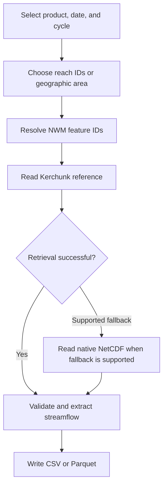

# Operational NWM Retrieval

Retrieve streamflow forecasts from the NOAA National Water Model (NWM) for river reaches in the contiguous United States (CONUS).

The `nwm-operational` command supports multiple forecast products, river-reach selection methods, validated Kerchunk reference caching, and CSV or Parquet output.

> **Scope:** This guide describes implemented capabilities. Some forecast products have been validated only for selected dates, cycles, and reaches. Full historical availability and scientific compatibility are not guaranteed.

## Contents

- [Quick start](#quick-start)
- [Installation](#installation)
- [Retrieval workflow](#retrieval-workflow)
- [Forecast products](#forecast-products)
- [Forecast timing](#forecast-timing)
- [Selecting reaches](#selecting-reaches)
- [Output formats](#output-formats)
- [Reference caching](#reference-caching)
- [Validation and limitations](#validation-and-limitations)

## Quick start

Retrieve a short-range forecast for NWM feature ID `3586192`:

```bash
uv run --locked --extra operational streamflow-getter nwm-operational \
  --date 2026-04-19 \
  --cycle 0 \
  --reach 3586192 \
  --start-hour 1 \
  --end-hour 2 \
  --out forecast.csv
```

The command requests forecast hours `f001` and `f002`. By default, it also includes an analysis timestep (`t0`). Add `--no-t0` to exclude that timestep.

The date and feature ID are documented validation examples. Data availability depends on the source archive.

## Installation

Requires Python 3.11 or newer and [uv](https://docs.astral.sh/uv/).

From the repository root, install the dependencies needed for your workflow:

| Extra | Purpose |
|---|---|
| `operational` | Operational NetCDF access and fallback |
| `spatial` | Point, bounding-box, and polygon selection |
| `parquet` | Parquet export |

For standard operational retrieval:

```bash
uv sync --extra operational
```

For all optional capabilities:

```bash
uv sync --extra operational --extra spatial --extra parquet
```

To inspect available CLI options:

```bash
uv run --locked streamflow-getter nwm-operational --help
```

## Retrieval workflow



The operational reader prefers Kerchunk references and uses native NetCDF for supported fallback conditions. The local reference cache can avoid downloading unchanged reference metadata.

## Forecast products

The following configurations are available through the operational CLI for CONUS.

| Product | Forecast cycles (UTC) | Available forecast leads |
|---|---|---|
| `short_range` | Every hour | f001–f018, hourly |
| `medium_range_mem1` | 00, 06, 12, 18 | f001–f240, hourly |
| `medium_range_mem2`–`medium_range_mem6` | 00, 06, 12, 18 | f001–f204, hourly |
| `medium_range_blend` | 00, 06, 12, 18 | f001–f240, hourly |
| `medium_range_no_da` | 00, 06, 12, 18 | f003–f240, every 3 hours |
| `long_range_mem1`–`long_range_mem4` | 00, 06, 12, 18 | f006–f720, every 6 hours |

The table describes the implemented product configurations. It does not establish complete source availability for every date or historical NWM version.

### Medium-range example

```bash
uv run --locked --extra operational streamflow-getter nwm-operational \
  --date 2026-04-19 \
  --cycle 0 \
  --product medium_range_mem2 \
  --reach 3586192 \
  --start-hour 1 \
  --end-hour 2 \
  --out medium_range.csv
```

### Long-range example

```bash
uv run --locked --extra operational streamflow-getter nwm-operational \
  --date 2026-04-19 \
  --cycle 0 \
  --product long_range_mem2 \
  --reach 3586192 \
  --start-hour 1 \
  --end-hour 12 \
  --no-t0 \
  --out long_range.csv
```

The long-range example selects `f006` and `f012`. It excludes `t0` because the scientific interpretation of the default analysis-to-long-range pairing has not been fully validated.

## Forecast timing

Forecast-hour windows are inclusive. The CLI selects only leads supported by the requested product.

| Product schedule | Example request | Selected leads |
|---|---|---|
| Hourly | Hours 1–3 | f001, f002, f003 |
| Every 3 hours | Hours 4–12 | f006, f009, f012 |
| Every 6 hours | Hours 1–12 | f006, f012 |

If the requested interval contains no valid forecast leads, the request is rejected.

### Analysis timestep (`t0`)

The operational CLI includes an initial analysis timestep by default.

- Most supported forecast products use `analysis_assim`.
- `medium_range_no_da` uses `analysis_assim_no_da`.
- The analysis and forecast records can have different reference times.
- Use `--no-t0` when only forecast lead records are required.

The analysis-to-forecast pairing for long-range ensembles has been tested for technical compatibility but has not been fully established as the scientifically intended initialization.

## Selecting reaches

Operational forecasts can be requested by NWM feature ID, USGS gage, geographic point, bounding box, or GeoJSON polygon.

| Method | Options | Required local dataset |
|---|---|---|
| Feature ID | `--reach` | None |
| USGS station | `--gage`, `--routelink` | Compatible RouteLink NetCDF |
| Point | `--point`, `--hydrofabric` | NWM channel hydrofabric |
| Bounding box | `--bbox`, `--hydrofabric` | NWM channel hydrofabric |
| Polygon | `--polygon`, `--hydrofabric` | NWM channel hydrofabric |

### NWM feature IDs

Use `--reach` to request a specific NWM channel. Repeat the option for multiple reaches.

```bash
uv run --locked --extra operational streamflow-getter nwm-operational \
  --date 2026-04-19 \
  --reach 3586192 \
  --reach 1122645 \
  --start-hour 1 \
  --end-hour 2 \
  --out reaches.csv
```

### USGS gage IDs

Use `--gage` with a compatible local RouteLink NetCDF file.

```bash
uv run --locked --extra operational streamflow-getter nwm-operational \
  --date 2026-04-19 \
  --gage 08165500 \
  --routelink /path/to/RouteLink_CONUS.nc \
  --start-hour 1 \
  --end-hour 2 \
  --out gage_forecast.csv
```

Preserve leading zeros in USGS station identifiers. RouteLink provides the mapping between station IDs and NWM feature IDs. Compatibility with historical NWM network versions must be verified separately.

### Geographic point

Use longitude and latitude in EPSG:4326.

```bash
uv run --locked --extra operational --extra spatial \
  streamflow-getter nwm-operational \
  --date 2026-04-19 \
  --point -99.3217121935161 30.0699307434853 \
  --hydrofabric /path/to/NWM_v3_hydrofabric.gdb \
  --max-distance-m 500 \
  --start-hour 1 \
  --end-hour 1 \
  --out point_forecast.csv
```

The command selects the nearest NWM channel within the configured maximum distance.

**Important:** The nearest geographic channel is not necessarily the correct hydrologic reach, especially near tributary junctions.

### Geographic bounding box

Supply coordinates in this order:

`WEST SOUTH EAST NORTH`

```bash
uv run --locked --extra operational --extra spatial \
  streamflow-getter nwm-operational \
  --date 2026-04-19 \
  --bbox -99.35 30.05 -99.30 30.09 \
  --hydrofabric /path/to/NWM_v3_hydrofabric.gdb \
  --max-reaches 100 \
  --start-hour 1 \
  --end-hour 1 \
  --out bbox_forecast.csv
```

The command selects NWM channels intersecting the bounding box.

### GeoJSON polygon

```bash
uv run --locked --extra operational --extra spatial \
  streamflow-getter nwm-operational \
  --date 2026-04-19 \
  --polygon /path/to/region.geojson \
  --hydrofabric /path/to/NWM_v3_hydrofabric.gdb \
  --max-reaches 100 \
  --start-hour 1 \
  --end-hour 1 \
  --out polygon_forecast.csv
```

Supported inputs include Polygon and MultiPolygon geometries, Features containing those geometries, and FeatureCollections containing exactly one polygonal Feature.

Coordinates must represent longitude and latitude in EPSG:4326. Coordinate values alone cannot independently establish the source coordinate reference system.

### Geographic selection safeguards

The default limit for bounding-box and polygon requests is 100 reaches. Use `--max-reaches` to configure the limit.

Requests exceeding the limit are rejected rather than silently truncated. This limit is a CLI safeguard, not a measured maximum retrieval capacity.

Duplicate NWM feature IDs are rejected. Geographic selection currently supports CONUS only.

## Output formats

Operational retrieval supports CSV and Parquet. Streamflow values are expressed in cubic meters per second (m³/s).

### CSV

```bash
uv run --locked --extra operational streamflow-getter nwm-operational \
  --date 2026-04-19 \
  --reach 3586192 \
  --start-hour 1 \
  --end-hour 2 \
  --format csv \
  --out forecast.csv
```

### Parquet

Parquet requires the `parquet` optional dependency group.

```bash
uv run --locked --extra operational --extra parquet \
  streamflow-getter nwm-operational \
  --date 2026-04-19 \
  --reach 3586192 \
  --start-hour 1 \
  --end-hour 2 \
  --format parquet \
  --out forecast.parquet
```

Operational records include streamflow values and source/forecast metadata. The output implementation defines the authoritative column schema.

## Reference caching

The operational reader can store validated Kerchunk reference records locally.

The cache implementation checks reference structure, source identity, SHA-256 integrity, remote ETag, source generation, and consistency of remote metadata during downloads.

Before checking the reference ETag, the metadata reader clears the reference path's and ancestor paths' in-memory S3 listing entries and requests fresh object metadata with `refresh=True`. This prevents stale listings from supplying an old ETag, an incorrect missing-file result, or an outdated size/ETag to a subsequent reference-body open. This listing-cache invalidation does not delete validated reference records on disk; the existing integrity and before/after metadata checks still govern their reuse and replacement.

Cached references are reused when their metadata remains valid. Missing or invalid local records can be replaced with validated downloads; source-generation changes are rejected when compatibility cannot be established.

Permission errors, directory misuse, and other local cache-read I/O errors propagate and stop reference-body download or cache replacement. A remote freshness-metadata check precedes the local cache read.

Operational CLI retrieval uses `~/.cache/streamflow_getter` by default. Use `--cache-dir PATH` to select another persistent reference-cache directory, or `--no-cache` to disable persistent reference caching for that request. `--cache-dir` and `--no-cache` are mutually exclusive. The default, explicit override, and opt-out modes have been exercised through live CLI retrieval; see [PROGRESS Section 4.7](../benchmarks/PROGRESS.md#47-operational-cli-cache-policy).

This default is a CLI policy. The lower-level Python retrieval functions retain their explicit `cache_dir=None` behavior so library callers do not begin writing persistent cache records implicitly.

### Preparing a reference before retrieval

The Python API can prepare one forecast or analysis reference without opening model arrays. Preparation and the Kerchunk reader share the same source resolution, reference validation, and cache implementation:

```python
from streamflow_getter.operational_nwm import (
    ForecastConfig,
    prepare_operational_reference,
    read_kerchunk_forecast,
)

config = ForecastConfig(date="2026-04-19", cycle=0, product="short_range")
cache_dir = "~/.cache/streamflow_getter"

prepared = prepare_operational_reference(config, 1, cache_dir=cache_dir)
print(prepared["source"])

result = read_kerchunk_forecast(
    config, 1, [3586192], cache_dir=cache_dir
)
```

The returned dictionary contains `source` (the resolved source descriptor), `reference` (the validated Kerchunk JSON), and `reference_json_bytes`. That size field preserves the reader's existing accounting: raw JSON length without caching, serialized reference length with caching. It is not a measurement of network transfer on cache hits.

Pass `hour=0` to prepare the matching analysis reference, including `analysis_assim_no_da` for a no-DA forecast. Analysis and forecast references use separate cache records. With `cache_dir=None`, preparation returns the validated reference without writing a cache record; persistent reuse requires an explicit cache directory.

Cached preparation may download the reference JSON and performs remote freshness checks, including native-source metadata requests. It does not open the NetCDF data arrays, extract flows, or validate decoded timestamps and reach availability; the reader performs those checks during retrieval. Subsequent retrieval checks freshness again, so preparation does not establish offline access.

If the S3 reference metadata lookup or reference-body open/read raises `FileNotFoundError`, preparation raises `RemoteReferenceNotFoundError` from `streamflow_getter.reference_cache`. This subclass of `FileNotFoundError` identifies the missing remote reference and retains the original exception as `__cause__`. Its message identifies the reference path and acquisition stage.

Native NetCDF source metadata failures, local cache read/write failures, authorization errors, other transport errors, and parsing/integrity errors retain their existing exception behavior. In particular, a local cache-write `FileNotFoundError` is not classified as a missing remote reference.

The retrieval coordinator, `fetch_operational_forecast`, uses native NetCDF fallback for `RemoteReferenceNotFoundError`, including when caching is enabled. All other cached retrieval errors propagate. This also covers a reference that disappears during the second metadata lookup after its body was downloaded: the existing cache record remains unchanged because replacement requires successful before/after checks. The preparation APIs themselves continue to raise the exception and never invoke native retrieval.

Fallback retrieves the current native object and applies the native reader's reach, flow, and timestamp checks. It does not establish equivalence to an older cached source generation or enable offline cache reuse. Successful fallback records the exception type and message in `fallback_reason`; if native retrieval also fails, the resulting `RuntimeError` retains the native exception as its cause and the Kerchunk reason as an exception note. The existing uncached fallback policy is unchanged.

This function prepares one explicitly selected reference. Use the batch API below to prepare a collection of forecast configurations.

### Preparing a batch of references

`prepare_operational_references` accepts a finite iterable of `ForecastConfig` objects and a shared inclusive forecast-hour window. This supports explicit selections across dates, cycles, products, and ensemble members:

```python
from streamflow_getter.operational_nwm import (
    ForecastConfig,
    prepare_operational_references,
)

configs = [
    ForecastConfig(date=day, cycle=0, product=product)
    for day in ("2026-04-19", "2026-04-20")
    for product in ("medium_range_mem1", "medium_range_mem2")
]
summaries = prepare_operational_references(
    configs, 1, 3, cache_dir="~/.cache/streamflow_getter"
)
print(len(summaries), "unique references prepared")
```

The complete configuration collection and each product's available leads are validated before metadata requests, reference downloads, or cache writes. A window invalid for any configuration stops the batch before acquisition; it is not silently shortened to fit that product. An explicit, nonempty cache directory is required.

Analysis t0 is included by default; pass `include_t0=False` to omit it. Sources are deduplicated by their full reference path and native URL, preserving first occurrence order. Ensemble members sharing an analysis reference prepare it once, while no-DA analysis, different dates/cycles, and distinct forecast files remain separate. This shares reference preparation; reuse of decoded t0 flow rows across ensemble series remains a separate task.

The returned list contains one compact summary per unique source: `forecast_date`, `forecast_cycle`, `domain`, `source`, and `reference_json_bytes`. The date and cycle describe the selection, not decoded dataset timestamps. Full reference JSON stays in the cache rather than accumulating in the result list; the existing single-reference size accounting applies.

Request validation does not establish remote availability. If acquisition fails partway through a batch, its exception propagates and later sources are not attempted. Missing remote references use the classification and preserved cause described above; batch preparation does not invoke the retrieval coordinator's native fallback. Earlier validated cache records remain available for a retry, with freshness checks still required. Date-range CLI selection, named events, default caching, and any broader cached-path fallback policy remain separate backend tasks under the roadmap.

## Validation and limitations

### Validated behavior

Automated and selected real-data tests have verified:

- Kerchunk and native NetCDF retrieval agreement for selected forecast products and leads.
- Forecast timestamps, source identity, and product-specific lead schedules.
- USGS station resolution through RouteLink.
- Geographic point, bounding-box, and polygon selection.
- CSV and Parquet output.
- Reference-cache integrity, reuse, and recovery.
- Controlled missing-reference fallback with a populated cache for the selected live case in [PROGRESS Section 5.5](../benchmarks/PROGRESS.md#55-controlled-cached-native-fallback).

The tests demonstrate these behaviors for the cases examined, not every possible NWM file.

### Known limitations

1. Operational geographic retrieval is currently limited to CONUS.
2. Full forecast horizons have not been retrieved and verified for every supported product.
3. Historical model versions may differ in product availability, feature IDs, and network definitions.
4. RouteLink and hydrofabric versions must be compatible with the intended NWM data.
5. The nearest geographic channel may not represent the intended hydrologic reach.
6. The scientific suitability of `analysis_assim` as `t0` for long-range ensemble forecasts requires further confirmation.
7. The default geographic reach limit is a safeguard, not a performance benchmark.
8. Further NWM retrospective and GEOGLOWS development requires the technical coordination specified in the project roadmap.

## Related documentation

- [Main README](../README.md) — project overview and quick start.
- [Project roadmap](ROADMAP.md) — requirements and development priorities.
- [NWM notes](nwm-notes.md) — background on NWM data and network versions.
- [Benchmark documentation](../benchmarks/README.md) — reproducible retrieval experiments.
- [Research progress](../benchmarks/PROGRESS.md) — historical validation evidence.
